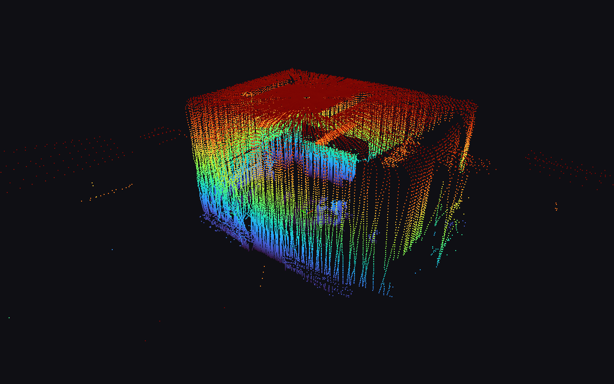
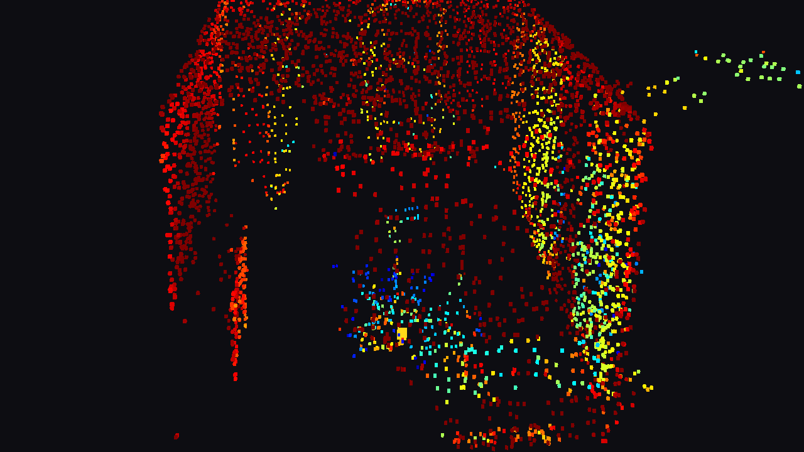

# Unitree 4D LiDAR L2 na Windows – zestaw dla studentów

Odbiór chmury punktów i IMU z lidaru **Unitree L2** po Ethernecie, **natywnie pod Windows**
(bez ROS, bez WSL): podgląd 3D na żywo, zapis do `.ply`, most **OSC** i gotowy projekt
**TouchDesigner**.

| Podgląd 3D | TouchDesigner |
|---|---|
|  |  |

---

## Czego potrzebujesz

- Windows 10 lub 11 (64-bit), konto z prawami administratora
- port Ethernet w komputerze **albo** przejściówka USB → Ethernet
- lidar Unitree L2, zasilacz 12 V, kabel Ethernet
- internet **podczas instalacji** (pobierany jest Python i ok. 300 MB pakietów)
- opcjonalnie: [TouchDesigner](https://derivative.ca/download) **2025.32460 lub nowszy** (darmowa wersja Non-Commercial wystarczy)

## Instalacja (ok. 5–10 minut)

1. **Pobierz paczkę:** na tej stronie zielony przycisk **Code → Download ZIP**.
2. **Rozpakuj** ZIP: prawy klik → *Wyodrębnij wszystko…* → np. do `Dokumenty`.
   Nie uruchamiaj niczego z wnętrza ZIP-a.
3. **Podłącz lidar** kablem do komputera i włącz zasilanie 12 V.
4. W rozpakowanym folderze kliknij dwa razy **`INSTALUJ.bat`**.
   - Jeśli pojawi się *„System Windows ochronił ten komputer”*: **Więcej informacji → Uruchom mimo to**.
   - Okno *„Czy chcesz zezwolić…”* (UAC): **Tak**.
5. Instalator sam:
   - znajdzie albo zainstaluje Pythona 3.11,
   - zainstaluje pakiety (numpy, open3d, python-osc) w folderze `venv` (nic nie miesza w systemie),
   - **zapyta, która karta sieciowa to lidar** – zaznaczona gwiazdką `*` jest najbardziej
     prawdopodobna, zwykle wystarczy **Enter**,
   - ustawi na niej adres `192.168.1.2` (bez bramy – internet dalej idzie przez Wi-Fi),
     doda regułę zapory i zapamięta poprzednie ustawienia (do cofnięcia),
   - zrobi skróty na pulpicie i przetestuje lidar.
6. Gotowe – na pulpicie masz **„Lidar L2 – podgląd 3D”** i **„Lidar L2 – OSC”**.

> Zimny lidar (poniżej ~30°C) po włączeniu najpierw się nagrzewa i przez pierwszą minutę
> może nie wysyłać punktów. To normalne.

## Używanie

### Podgląd 3D – `start-viewer.bat`

| Klawisz | Akcja |
|---|---|
| **S** | zapisz chmurę do `scans\l2_RRRRMMDD_GGMMSS.ply` (x, y, z, intensity, RGB – otworzysz w CloudCompare, MeshLab, Blenderze) |
| **C** | kolor: intensywność ↔ wysokość |
| **+ / −** | więcej / mniej klatek w akumulacji (L2 skanuje powoli – ok. 1 s daje pełny obraz) |
| **Spacja** | pauza |
| **R** | wycentruj widok |
| **Q** / Esc | wyjście |
| mysz | lewy – obrót, prawy / Shift – przesuw, kółko – zoom |

### OSC – `start-osc.bat`

Wysyła dane na `127.0.0.1:9000`. Zostaw okno otwarte; zamknięcie okna zatrzymuje most.
Podgląd 3D i OSC mogą działać **jednocześnie**.

| Adres | Wartości (float) |
|---|---|
| `/l2/imu` | `w x y z  roll pitch yaw  ax ay az  gx gy gz` (13) |
| `/l2/imu/quat` | `w x y z` |
| `/l2/imu/euler` | `roll pitch yaw` [°] |
| `/l2/imu/acc` | `ax ay az` [m/s²] |
| `/l2/imu/gyro` | `gx gy gz` [rad/s] |
| `/l2/cloud` | `x y z i` × do 400 punktów (losowy, równomierny podzbiór), [m], `i` = intensywność 0..1 |
| `/l2/cloud/count` | liczba punktów w ostatnim `/l2/cloud` |
| `/l2/grid` | siatka zajętości z góry 32×32 (0..1), wiersz po wierszu, wiersz 0 = +Y, środek = lidar |
| `/l2/grid/info` | `W H rozmiar_komórki_m zasięg_m` |

Układ współrzędnych lidaru: **Z w górę**.

### TouchDesigner – folder `touchdesigner\`

1. Uruchom **`start-osc.bat`**.
2. Otwórz **`touchdesigner\LidarL2.toe`**
   – albo przeciągnij **`touchdesigner\lidar_l2.tox`** do własnego projektu.

W komponencie `lidar`:

| Operator | Co robi |
|---|---|
| `oscin` + `oscin_callbacks` | odbiór OSC (port 9000) |
| `imu` | CHOP z 13 kanałami IMU |
| `cloud` | CHOP `tx ty tz i r g b` – już w osiach TD (Y w górę) |
| `geo` + `render` → `out` | chmura jako instancje, kamera krąży |
| `imu_box` | żółta bryłka obracana jak lidar |
| `grid` → `grid_view` | widok z góry jako obraz |

Parametry komponentu (strona **Lidar**): **Accum** – ile paczek `/l2/cloud` łączyć
(15 ≈ 6000 punktów), **Pointsize**, **Orbitspeed** (0 = kamera stoi).

## Ustawienia

Otwórz `.bat` w Notatniku (prawy klik → *Edytuj*) i zmień wartości po `=`:

- `start-viewer.bat`: `FRAMES` (klatki w akumulacji, 12 ≈ 1 s), `COLOR` (`intensity` / `height`), `POINT_SIZE`
- `start-osc.bat`: `OSC_HOST` (IP odbiorcy – inny komputer w sieci też może być), `OSC_PORT`,
  `POINTS`, `FRAMES`, `CLOUD_RATE`, `IMU_RATE`, `GRID`

Wszystkie opcje: `venv\Scripts\python.exe app\osc_bridge.py --help` (oraz `viewer.py`, `l2_receiver.py`).

## Pliki w paczce

| Plik | Do czego |
|---|---|
| `INSTALUJ.bat` | instalacja |
| `start-viewer.bat` / `start-osc.bat` | podgląd 3D / most OSC |
| `sprawdz-lidar.bat` | diagnostyka: ping, wersja, tryb pracy, 5 s odbioru |
| `wlacz-imu.bat` | włącza IMU w lidarze, jeśli ktoś je wyłączył |
| `skonfiguruj-siec.bat` | ponowna konfiguracja sieci (np. inna przejściówka USB-Ethernet) |
| `przywroc-siec.bat` | cofa zmiany sieci |
| `odinstaluj.bat` | cofa sieć, usuwa `venv` i skróty |
| `app\` | kod: `l2_receiver.py` (protokół), `viewer.py`, `osc_bridge.py` |
| `touchdesigner\` | `LidarL2.toe`, `lidar_l2.tox` |

## Typowe problemy

| Objaw | Co zrobić |
|---|---|
| Podgląd pusty / OSC „CZEKAM NA DANE” | Zasilanie i kabel. Zimny lidar – odczekaj 1–2 min. Uruchom `sprawdz-lidar.bat`. |
| Ping nie działa | Kabel w złej karcie albo karta nieskonfigurowana – `skonfiguruj-siec.bat`. Przejściówka USB w innym porcie = dla Windows nowa karta → skonfiguruj ponownie. |
| Ping działa, danych brak | Lidar w trybie standby? `venv\Scripts\python.exe app\l2_receiver.py --cmd start`. Sprawdź, czy antywirus/zapora firmowa nie blokuje UDP 6201. |
| Brak IMU (`IMU 0`) | `wlacz-imu.bat` (zamknij wcześniej podgląd i OSC). |
| Okienko „Nie mogę zbindować…” | Działają już 2 programy naraz (limit) albo karta nie ma adresu 192.168.1.2. |
| Po zamknięciu jednego programu drugi przestał dostawać dane | Zamknięty był „głównym” odbiorcą. Uruchom ponownie ten, który został. |
| Instalacja pakietów nie działa | Sieć uczelniana z proxy / bez internetu – spróbuj w innej sieci. Szczegóły w `install.log`. |
| Nie mam internetu po kablu | Instalator wyłączył DHCP na tej karcie. `przywroc-siec.bat` przywraca poprzedni stan. |
| TouchDesigner nie dostaje danych | Najpierw `start-osc.bat`; w TD sprawdź `oscin` (port 9000, Active). Inny program na porcie 9000? Zmień `OSC_PORT` i port w `oscin`. |
| TD nie otwiera `.toe` | Za stara wersja TD – zaktualizuj albo przeciągnij `.tox` do pustego projektu. |

## Cofnięcie zmian

- **`przywroc-siec.bat`** – przywraca kartę sieciową do stanu sprzed instalacji (DHCP lub poprzednie
  adresy, na podstawie `network-backup.json`) i usuwa regułę zapory.
- **`odinstaluj.bat`** – to samo + usuwa `venv` i skróty. Potem można skasować cały folder.

## Dla zaawansowanych

### Test z linii poleceń

```
venv\Scripts\python.exe app\l2_receiver.py                 # statystyki, 10 pierwszych punktów, IMU
venv\Scripts\python.exe app\l2_receiver.py --cmd version   # wersja sprzętu/firmware
venv\Scripts\python.exe app\l2_receiver.py --cmd config    # tryb pracy
venv\Scripts\python.exe app\l2_receiver.py --cmd stop      # standby (start = obroty)
venv\Scripts\python.exe app\l2_receiver.py --cmd reset     # restart lidaru
```

### Użycie w własnym kodzie Pythona

```python
import sys; sys.path.insert(0, r"app")
from l2_receiver import L2Receiver
rx = L2Receiver().start()
xyz, intensity = rx.get_points(frames=12)   # ~1 s chmury, numpy Nx3 [m]
imu = rx.last_imu                           # .quaternion (w,x,y,z), .euler_deg(), .linear_acceleration
```

### Tryb pracy lidaru

Liczba bitowa zapisana w lidarze: bit 0 – FOV 192° (zamiast 180°), bit 1 – 2D, bit 2 – IMU **wyłączone**,
bit 3 – port szeregowy (**odcina Ethernet**), bit 4 – bez autostartu. Fabrycznie 0.
`--set-work-mode N` zmienia tryb (bit 3 jest blokowany), potem `--cmd reset`.

### Sieć

Lidar: `192.168.1.62:6101` → komputer: `192.168.1.2:6201` (UDP). Drugi program odbiera
przez przekaźnik `127.0.0.1:6202`.

### Różnice względem dokumentacji SDK (sprawdzone na sprzęcie, firmware 2.8.11.1)

- CRC32 liczony jest **tylko z danych** (bez 12-bajtowego nagłówka), także dla wysyłanych komend.
- Pakiet chmury ma 1044 B (nie 1036), IMU 80 B; ok. 216 pakietów chmury/s i 250 IMU/s.
- Jeden datagram UDP może zawierać kilka sklejonych pakietów.
- Kwaternion IMU ma kolejność **(w, x, y, z)**.
- Przeliczenie na XYZ 1:1 z `parseFromPacketToPointCloud()` z
  [unilidar_sdk2](https://github.com/unitreerobotics/unilidar_sdk2).

## Licencja

MIT – patrz [LICENSE](LICENSE). Fragmenty protokołu na podstawie unilidar_sdk2 (BSD-3),
patrz [THIRD_PARTY_NOTICES.md](THIRD_PARTY_NOTICES.md).
